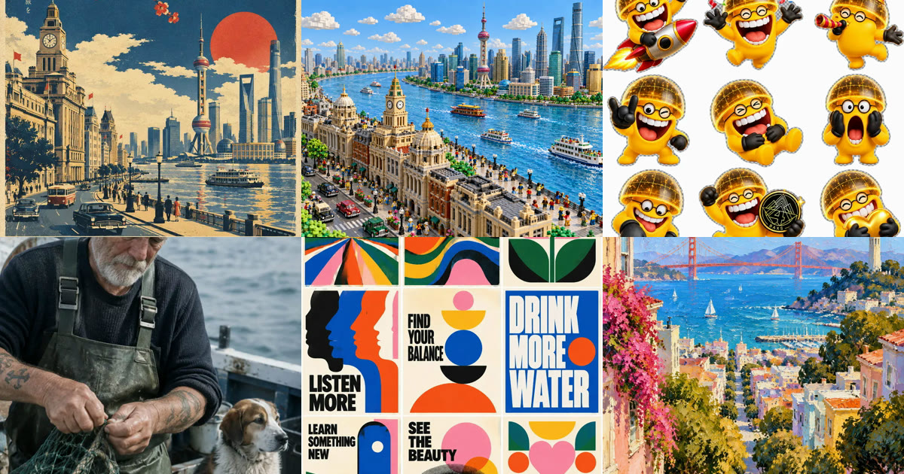

<div align="center">

<a href="https://apiko.app/zh-tw/gpt-image-2-5-prompts?utm_source=github&utm_medium=banner&utm_campaign=awesome-gpt-image-2.5-prompts"></a>

[](LICENSE)
[](README_zh-TW.md#menu)
[](https://apiko.app/zh-tw/models/gpt-image-2.5-flare?utm_source=github&utm_medium=badge&utm_campaign=awesome-gpt-image-2.5-prompts&utm_content=model_try)
[](https://apiko.app/zh-tw/docs/api-manual/image-series/gpt-image-2.5-flare/images?utm_source=github&utm_medium=badge&utm_campaign=awesome-gpt-image-2.5-prompts&utm_content=docs)

[](README.md)
[](README_zh-CN.md)
[](README_zh-TW.md)
[](README_ko.md)

</div>

# Awesome GPT Image 2.5 提示詞

<a id="introduction"></a>
## 🌟 簡介

**GPT Image 2.5 提示詞：209 條可直接複製的範例，附效果圖，涵蓋人像、海報、介面設計、精靈圖與圖片編輯。**

複製一條已經產出好圖的 GPT Image 2.5 提示詞，或送到試玩區改幾處細節再跑。

線上搜尋與篩選： [apiko.app/gpt-image-2-5-prompts](https://apiko.app/zh-tw/gpt-image-2-5-prompts?utm_source=github&utm_medium=readme&utm_campaign=awesome-gpt-image-2.5-prompts&utm_content=intro).

> [!NOTE]
> 提示詞保持作者發布時的原文，所以大多是英文；標題與簡介由我們撰寫。每則都署名作者並連結原帖。

<a id="quick-start"></a>
## 🚀 快速開始

**網頁上用：** 每則都有「在 APIKO 執行」連結，會在 [apiko.app](https://apiko.app/zh-tw/gpt-image-2-5-prompts?utm_source=github&utm_medium=quickstart&utm_campaign=awesome-gpt-image-2.5-prompts&utm_content=browser) 開啟這則範例；點「使用」，提示詞就會填進 GPT Image 2.5 試用台。

**用 API：** 先建立 [APIKO API 金鑰](https://apiko.app/zh-tw/dashboard/apikeys?utm_source=github&utm_medium=quickstart&utm_campaign=awesome-gpt-image-2.5-prompts&utm_content=api_key)，再建立非同步任務並輪詢，直到圖片生成完成。

```bash
export APIKO_API_KEY="your_key_here"

TASK_ID=$(curl -s https://api.apiko.app/v1/images/generations \
  -H "Authorization: Bearer $APIKO_API_KEY" \
  -H "Content-Type: application/json" \
  -d '{
  "model": "gpt-image-2.5-flare",
  "prompt": "A minimalist poster of a paper boat on a calm lake at sunrise, the title \"Morning\" in bold serif type.",
  "size": "16:9",
  "resolution": "1k",
  "quality": "medium",
  "async": true
}' | python3 -c 'import json,sys; print(json.load(sys.stdin)["id"])')

# When status is "completed", the image is at data[0].url (kept for 24 hours).
while :; do
  TASK=$(curl -s https://api.apiko.app/v1/tasks/$TASK_ID \
    -H "Authorization: Bearer $APIKO_API_KEY")
  printf '%s\n' "$TASK"
  printf '%s' "$TASK" | grep -qE '"status": *"(completed|failed)"|"error": *\{' && break
  sleep 5
done
```

介面: `POST https://api.apiko.app/v1/images/generations` (建立任務) · `GET https://api.apiko.app/v1/tasks/{id}` (查詢狀態與結果)

<a id="how-to-write"></a>
## ✍️ GPT Image 2.5 提示詞怎麼寫

這些提示詞裡反覆出現的五種結構。

- **攝影** · `主體 + 動作 + 機位與鏡頭 + 光線 + 質感` — 人像提示詞會寫明鏡頭（如 50mm）、景別、光線與皮膚或材質細節，最後補上要避免的內容，例如過度修圖。
- **精確文字** · `加引號的文字 + 擺放位置 + 字體樣式` — 畫面中要出現的每個字都放進引號，說清楚每行放哪裡、長什麼樣子，文字較長時要求拼寫正確。
- **編輯** · `一處修改 + 「其餘維持不變」` — 編輯類提示詞只說一處修改，結尾列出必須保留的部分：臉部、版面、光線。
- **整頁或網格** · `數量 + 網格規格 + 每格內容 + 背景` — 貼圖、精靈圖與海報陣列會寫明格數、排列方式，以及背景是透明還是純色。
- **結構化描述** · `標題、場景、主體、光線、構圖等欄位` — 較長的提示詞寫成 JSON 或 Markdown 大綱，可重複使用的會留下 {主體}、[OBJECT] 這類佔位符待填。

**從範例看到什麼**

- **把畫幅寫進提示詞。** 不少提示詞在內文寫明 9:16、3:4、1:3 之類的比例與 4K 解析度，讓構圖與輸出尺寸對得上。
- **用真實媒材或年代定風格。** 「昭和旅行海報」「1994 年電視購物」「90 年代賽璐珞動畫」幾個字就能交代整體畫風。
- **把 emoji 變成材質。** 有幾條提示詞拿一個 emoji 渲染成鍍鉻、絲綢、絨毛、紙藝或充氣物，很容易做出一組風格一致的圖示。
- **依元件描述介面。** 介面類提示詞會列出色彩模式、版面、字體層級與區塊，而不是只說「好看的網站」。
- **替上傳的圖編號。** 參考圖提示詞會寫「第二張圖」「圖 2」，讓模型分清哪張提供主體、哪張提供場景。
- **動畫幀要鎖定比例。** 精靈圖提示詞固定幀數、網格與角色大小，之後切圖時各幀才對得齊。

<a id="menu"></a>
## 📑 目錄

- [⭐ 精選](#featured) (6)
- [📷 人像攝影](prompts/portrait-photography_zh-TW.md) (31) — 像攝影師的拍攝需求一樣寫：鏡頭、光線、皮膚質感與情緒。
- [🧩 角色與貼圖](prompts/characters-stickers_zh-TW.md) (35) — 角色設定頁、Q 版公仔、表情貼圖與像素精靈圖，依固定網格排列。
- [🏞️ 場景與插畫](prompts/scenes-illustration_zh-TW.md) (35) — 城市、微縮模型、繪畫與超現實畫面，都指定了具體媒材或年代。
- [🪧 海報與品牌](prompts/poster-branding_zh-TW.md) (28) — 海報、封面、標誌與卡片，文字必須一字不差。
- [📣 產品與廣告](prompts/product-ads_zh-TW.md) (23) — 產品圖、包裝、廣告看板與廣告創意，包含把 emoji 變成實物。
- [🖥️ 介面與網頁設計](prompts/ui-web_zh-TW.md) (24) — App 畫面、登陸頁區塊與桌面截圖，逐個元件寫清楚。
- [📊 資訊圖](prompts/infographics_zh-TW.md) (14) — 圖解、教學圖、食譜與簡報，標籤與版面都寫明。
- [✏️ 圖片編輯](prompts/image-editing_zh-TW.md) (19) — 只改上傳照片中的一處，其餘維持原樣的提示詞。
- [❓ 常見問題](#faq)
- [🔗 相關連結](#related)

<a id="featured"></a>
## ⭐ 精選

<a id="poster-branding-05"></a>
### 106. 昭和風日本旅行海報

作者 [@Goodmanprotocol](https://x.com/Goodmanprotocol/status/2097542746273726753) · 3:4 · **[▶ 在 APIKO 執行](https://apiko.app/zh-tw/gpt-image-2-5-prompts?utm_source=github&utm_medium=case&utm_campaign=awesome-gpt-image-2.5-prompts&utm_content=poster-branding-05#poster-branding-05)** · [原帖](https://x.com/Goodmanprotocol/status/2097542746273726753)

<a href="https://apiko.app/zh-tw/gpt-image-2-5-prompts?utm_source=github&utm_medium=case&utm_campaign=awesome-gpt-image-2.5-prompts&utm_content=poster-branding-05#poster-branding-05"></a>

**提示詞:**

```text
Create a premium, ultra-refined Showa-era Japanese vintage travel poster for [LOCATION].

FORMAT: Vertical 3:4 | Collector’s travel poster | Mid-century Japanese railway tourism aesthetic

CORE CONCEPT

Create a beautifully composed, instantly recognizable travel scene representing [LOCATION]. Feature its most iconic landmark, architecture, landscape, streets, transportation, and atmospheric details, selecting elements that naturally define the destination.

Reimagine the scene as an authentic 1960s–1970s Japanese railway tourism poster, inspired by classic Japanese National Railways travel advertising and sophisticated vintage screen-printed graphics.

The result should feel like an originally designed vintage poster, not a modern photograph with a retro filter.

VISUAL STYLE

Use bold geometric forms, simplified architecture, clean perspective lines, strong silhouettes, and elegant flat graphic shapes.

Combine sophisticated mid-century Japanese graphic design with traditional screen-print and lithographic aesthetics. Keep the composition cinematic, balanced, spacious, and visually striking.

People and vehicles should be minimal and stylized rather than photorealistic.

COLOR & PRINT TEXTURE

Use a restrained vintage palette of:
deep navy blue, warm ivory/aged paper, muted mustard yellow, and vermilion red accents.

Use flat printed color fields rather than digital gradients. Add subtle paper grain, authentic ink texture, slight ink wear, and delicate vintage print misregistration for a convincing screen-printed feel.

Avoid neon colors, glossy 3D rendering, excessive photorealism, modern AI-art aesthetics, and overly saturated colors.

TYPOGRAPHY & LAYOUT

Reserve generous negative space at the bottom for elegant vintage typography.

Main title: "[LOCATION]"
Large, bold, geometric sans-serif lettering.

Add a refined, location-appropriate subtitle beneath it with generous letter spacing.

Place 2026 discreetly at the bottom left and No.01 at the bottom right.

Typography should feel authentic to a premium Japanese railway tourism poster: restrained, elegant, highly legible, and perfectly integrated into the artwork.

FINAL RESULT

Create a timeless, sophisticated Japanese Showa-era travel poster that feels like a rare original screen-printed railway advertisement from the 1960s–1970s, while showcasing the unique identity, beauty, and most recognizable visual characteristics of [LOCATION].

IMPORTANT: Make [LOCATION] immediately recognizable. Prioritize iconic local landmarks, authentic architecture, distinctive landscapes, and culturally characteristic details. Do not invent generic scenery that could represent any destination.
```

<a id="scenes-illustration-13"></a>
### 79. 樂高積木版上海外灘

作者 [@LaplaceYoung](https://github.com/LaplaceYoung/awesome-gpt-image-2.5/blob/main/docs/cases/033-imported-.md) · 4:3 · **[▶ 在 APIKO 執行](https://apiko.app/zh-tw/gpt-image-2-5-prompts?utm_source=github&utm_medium=case&utm_campaign=awesome-gpt-image-2.5-prompts&utm_content=scenes-illustration-13#scenes-illustration-13)** · [原帖](https://github.com/LaplaceYoung/awesome-gpt-image-2.5/blob/main/docs/cases/033-imported-.md)

<a href="https://apiko.app/zh-tw/gpt-image-2-5-prompts?utm_source=github&utm_medium=case&utm_campaign=awesome-gpt-image-2.5-prompts&utm_content=scenes-illustration-13#scenes-illustration-13"></a>

**提示詞:**

```text
创作一幅高度精细且色彩鲜艳的乐高版上海外滩景象。前景是经典的外滩历史建筑群，用乐高砖块精致还原西式与新古典主义立面，包括钟楼、穹顶与柱廊；乐高小人们沿江漫步、拍照、观光，街道旁停着经典样式的乐高汽车。中景是蓝色半透明乐高砖拼出的黄浦江，江上有乐高渡轮与游览船。对岸陆家嘴高楼林立：东方明珠塔、上海中心、金茂大厦等超现代乐高摩天楼色彩丰富、造型逼真。天空为乐高明亮蓝色，点缀白色积木云朵，午后阳光，等距俯视全景。
```

<a id="characters-stickers-03"></a>
### 34. 九枚透明背景 3D 表情貼圖

作者 [@BAXSCTO](https://x.com/BAXSCTO/status/2097554076494102704) · 1:1 · **[▶ 在 APIKO 執行](https://apiko.app/zh-tw/gpt-image-2-5-prompts?utm_source=github&utm_medium=case&utm_campaign=awesome-gpt-image-2.5-prompts&utm_content=characters-stickers-03#characters-stickers-03)** · [原帖](https://x.com/BAXSCTO/status/2097554076494102704)

<a href="https://apiko.app/zh-tw/gpt-image-2-5-prompts?utm_source=github&utm_medium=case&utm_campaign=awesome-gpt-image-2.5-prompts&utm_content=characters-stickers-03#characters-stickers-03"></a>

**提示詞:**

```text
基于我上传的图片，
设计一套  3D 表情包 1:1 透明贴纸页，
包含 9 个各不相同的贴纸，
按 3X3 网格排列每个贴纸呈现不同的表情、姿势或反应。贴纸之间留出较宽且完全透明的间隔。
无背景、阴影或重叠元素，融入🚀🎉🥳🤟
```

<a id="portrait-photography-01"></a>
### 1. 漁船上補網的飽經風霜老水手

作者 [@OpenAI](https://developers.openai.com/api/docs/guides/image-prompting#control-style-and-lighting) · 2:3 · **[▶ 在 APIKO 執行](https://apiko.app/zh-tw/gpt-image-2-5-prompts?utm_source=github&utm_medium=case&utm_campaign=awesome-gpt-image-2.5-prompts&utm_content=portrait-photography-01#portrait-photography-01)** · [原帖](https://developers.openai.com/api/docs/guides/image-prompting#control-style-and-lighting)

<a href="https://apiko.app/zh-tw/gpt-image-2-5-prompts?utm_source=github&utm_medium=case&utm_campaign=awesome-gpt-image-2.5-prompts&utm_content=portrait-photography-01#portrait-photography-01"></a>

**提示詞:**

```text
Create a photorealistic candid photograph of an elderly sailor standing on a small fishing boat.
He has weathered skin with visible wrinkles, pores, and sun texture, and a few faded traditional sailor tattoos on his arms.
He is calmly adjusting a net while his dog sits nearby on the deck. Shot like a 35mm film photograph, medium close-up at eye level, using a 50mm lens.
Soft coastal daylight, shallow depth of field, subtle film grain, natural color balance.
The image should feel honest and unposed, with real skin texture, worn materials, and everyday detail. No glamorization, no heavy retouching.
```

<a id="poster-branding-08"></a>
### 109. 中世紀現代風 3×3 海報陣列

作者 [@LaplaceYoung](https://github.com/LaplaceYoung/awesome-gpt-image-2.5/blob/main/docs/cases/06-mid-century-modern-posters.md) · 3:4 · **[▶ 在 APIKO 執行](https://apiko.app/zh-tw/gpt-image-2-5-prompts?utm_source=github&utm_medium=case&utm_campaign=awesome-gpt-image-2.5-prompts&utm_content=poster-branding-08#poster-branding-08)** · [原帖](https://github.com/LaplaceYoung/awesome-gpt-image-2.5/blob/main/docs/cases/06-mid-century-modern-posters.md)

<a href="https://apiko.app/zh-tw/gpt-image-2-5-prompts?utm_source=github&utm_medium=case&utm_campaign=awesome-gpt-image-2.5-prompts&utm_content=poster-branding-08#poster-branding-08"></a>

**提示詞:**

```text
Create a perfectly aligned 3 x 3 grid of nine mid-century modern motivational posters sharing one limited palette.
Exact headlines: Travel Farther, CREATE, GROW TOGETHER, LISTEN MORE, FIND YOUR BALANCE, DRINK MORE WATER, LEARN SOMETHING NEW, SEE THE BEAUTY, CHOOSE KINDNESS.
Flat printed poster aesthetic, equal gutters, no mockup frames.
```

<a id="scenes-illustration-04"></a>
### 70. 印象派水粉厚塗城市風景

作者 [@LaplaceYoung](https://github.com/LaplaceYoung/awesome-gpt-image-2.5/blob/main/docs/cases/11-impressionist-cityscape.md) · 3:4 · **[▶ 在 APIKO 執行](https://apiko.app/zh-tw/gpt-image-2-5-prompts?utm_source=github&utm_medium=case&utm_campaign=awesome-gpt-image-2.5-prompts&utm_content=scenes-illustration-04#scenes-illustration-04)** · [原帖](https://github.com/LaplaceYoung/awesome-gpt-image-2.5/blob/main/docs/cases/11-impressionist-cityscape.md)

<a href="https://apiko.app/zh-tw/gpt-image-2-5-prompts?utm_source=github&utm_medium=case&utm_campaign=awesome-gpt-image-2.5-prompts&utm_content=scenes-illustration-04#scenes-illustration-04"></a>

**提示詞:**

```text
A vertical impressionist gouache and thick-oil painting of San Francisco on a bright clear day.
View downhill along a steep residential street toward San Francisco Bay. Pastel-colored houses and dense rounded trees frame both sides of the descending street.
In the distance, the Golden Gate Bridge stretches horizontally across brilliant blue water, painted in vivid vermilion red. Coit Tower appears on the right hillside.
Joyful saturated palette, loose confident brushwork, visible thick paint texture, palette-knife marks.
Mid-century California plein-air painting feeling. 3:4. No text. No photographic rendering.
```

- **[📷 查看「人像攝影」全部 31 則](prompts/portrait-photography_zh-TW.md)**
- **[🧩 查看「角色與貼圖」全部 35 則](prompts/characters-stickers_zh-TW.md)**
- **[🏞️ 查看「場景與插畫」全部 35 則](prompts/scenes-illustration_zh-TW.md)**
- **[🪧 查看「海報與品牌」全部 28 則](prompts/poster-branding_zh-TW.md)**
- **[📣 查看「產品與廣告」全部 23 則](prompts/product-ads_zh-TW.md)**
- **[🖥️ 查看「介面與網頁設計」全部 24 則](prompts/ui-web_zh-TW.md)**
- **[📊 查看「資訊圖」全部 14 則](prompts/infographics_zh-TW.md)**
- **[✏️ 查看「圖片編輯」全部 19 則](prompts/image-editing_zh-TW.md)**

<a id="faq"></a>
## ❓ 常見問題

<details>
<summary><b>這些 GPT Image 2.5 提示詞可以免費使用嗎？</b></summary>

提示詞可以自由複製、修改與執行。提示詞與效果圖歸每張卡片標註的創作者所有，若要把效果圖用在商業用途，請先看原始貼文。

</details>

<details>
<summary><b>GPT Image 2.5 提示詞要用中文還是英文寫？</b></summary>

中文與英文都可以。這裡的提示詞保留作者的原文、沒有翻譯，直接複製即可。

</details>

<details>
<summary><b>如何用 API 執行一條 GPT Image 2.5 提示詞？</b></summary>

把提示詞送到圖像生成端點，model 填 gpt-image-2.5-flare 或 gpt-image-2.5-sunburst。prompt 為必填，n 只能是 1。文件建議傳 "async": true，每 5 到 10 秒輪詢一次 GET /v1/tasks/:task_id，完成的結果會保存 24 小時。

</details>

<details>
<summary><b>GPT Image 2.5 支援哪些尺寸？</b></summary>

解析度有 1k、2k、4k，size 可選十種比例：3:1、21:9、16:9、3:2、4:3、1:1、3:4、2:3、9:16、1:3。每個比例在每個檔位都對應固定像素，列在 API 頁面。

</details>

<details>
<summary><b>GPT Image 2.5 可以用參考圖修圖嗎？</b></summary>

可以。API 支援 0 到 16 張參考圖與遮罩，本頁的圖片編輯卡片就是這樣用的，遮罩可以把修改限制在某個區域。

</details>

<details>
<summary><b>GPT Image 2.5 如何計費？</b></summary>

依每個結果實際用到的 token 計費，不是按張數。畫質可選 low、medium、high、xhigh、max 或 auto，畫質越高輸出 token 越多。目前費率請看模型頁。

</details>

<details>
<summary><b>gpt-image-2.5-flare 與 gpt-image-2.5-sunburst 有什麼差別？</b></summary>

APIKO 文件中兩者的參數、尺寸、參考圖上限與 token 計費完全相同，沒有寫明其他差異。本頁的提示詞用哪個 ID 都能跑。

</details>

<details>
<summary><b>為什麼我用 GPT Image 2.5 跑出來和卡片上的圖不一樣？</b></summary>

圖像模型不是確定性的，同一條提示詞每次跑的結果都不同。作者也可能用了別的設定或工具，或在出圖後做過修改。

</details>

<details>
<summary><b>怎樣讓 GPT Image 2.5 把文字寫對？</b></summary>

把文字放進引號，說明每行的位置與字體樣子，文字盡量簡短。上面的海報與品牌卡片可以參考，出圖後仍要逐字檢查拼寫。

</details>


<a id="related"></a>
## 🔗 相關連結

- [GPT Image 2.5 提示詞 · apiko.app](https://apiko.app/zh-tw/gpt-image-2-5-prompts?utm_source=github&utm_medium=related&utm_campaign=awesome-gpt-image-2.5-prompts)
- [GPT Image 2.5 Flare](https://apiko.app/zh-tw/models/gpt-image-2.5-flare?utm_source=github&utm_medium=related&utm_campaign=awesome-gpt-image-2.5-prompts)
- [GPT Image 2.5 Sunburst](https://apiko.app/zh-tw/models/gpt-image-2.5-sunburst?utm_source=github&utm_medium=related&utm_campaign=awesome-gpt-image-2.5-prompts)
- [GPT Image 2](https://apiko.app/zh-tw/models/gpt-image-2?utm_source=github&utm_medium=related&utm_campaign=awesome-gpt-image-2.5-prompts)
- [GPT Image 2 提示詞](https://apiko.app/zh-tw/gpt-image-2-prompts?utm_source=github&utm_medium=related&utm_campaign=awesome-gpt-image-2.5-prompts)
- [AI 圖片生成器](https://apiko.app/zh-tw/image-generator?utm_source=github&utm_medium=related&utm_campaign=awesome-gpt-image-2.5-prompts)
- [APIKO API 程式碼範例](https://github.com/tong0619453646-dev/apiko-ai-api-examples)

**更多提示詞合集**

- [Awesome Seedance 2.5 Prompts](https://github.com/tong0619453646-dev/awesome-seedance-2.5-prompts/blob/main/README_zh-TW.md)
- [Awesome GPT Image 2.6 Prompts](https://github.com/tong0619453646-dev/awesome-gpt-image-2.6-prompts/blob/main/README_zh-TW.md)
- [Awesome Nano Banana 2.1 Prompts](https://github.com/tong0619453646-dev/awesome-nano-banana-2.1-prompts/blob/main/README_zh-TW.md)
- [Awesome GPT Image 2 Prompts](https://github.com/tong0619453646-dev/awesome-gpt-image-2-prompts/blob/main/README_zh-TW.md)
- [Awesome Claude Opus 5.5 Video Prompts](https://github.com/tong0619453646-dev/awesome-claude-opus-5.5-video-prompts/blob/main/README_zh-TW.md)
- [Awesome Wan 3.0 Prompts](https://github.com/tong0619453646-dev/awesome-wan-3.0-prompts/blob/main/README_zh-TW.md)

<a id="license"></a>
## 📄 授權與出處

提示詞與效果圖歸每張卡片標註的創作者所有，卡片可連到原始貼文。標題、簡介、譯文與生成腳本採用 [CC BY 4.0](LICENSE) 授權。來源倉庫的授權條款見 [THIRD_PARTY_NOTICES.md](THIRD_PARTY_NOTICES.md)。

如果這份合集幫你省了時間，按個 ⭐ 能讓更多人看到。
